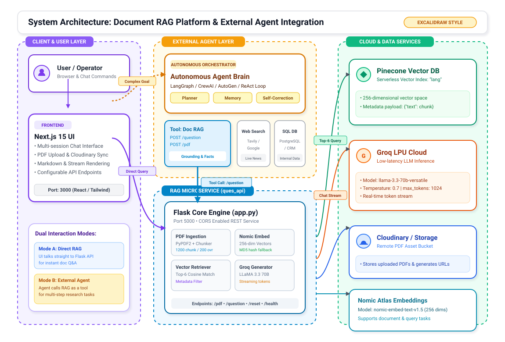
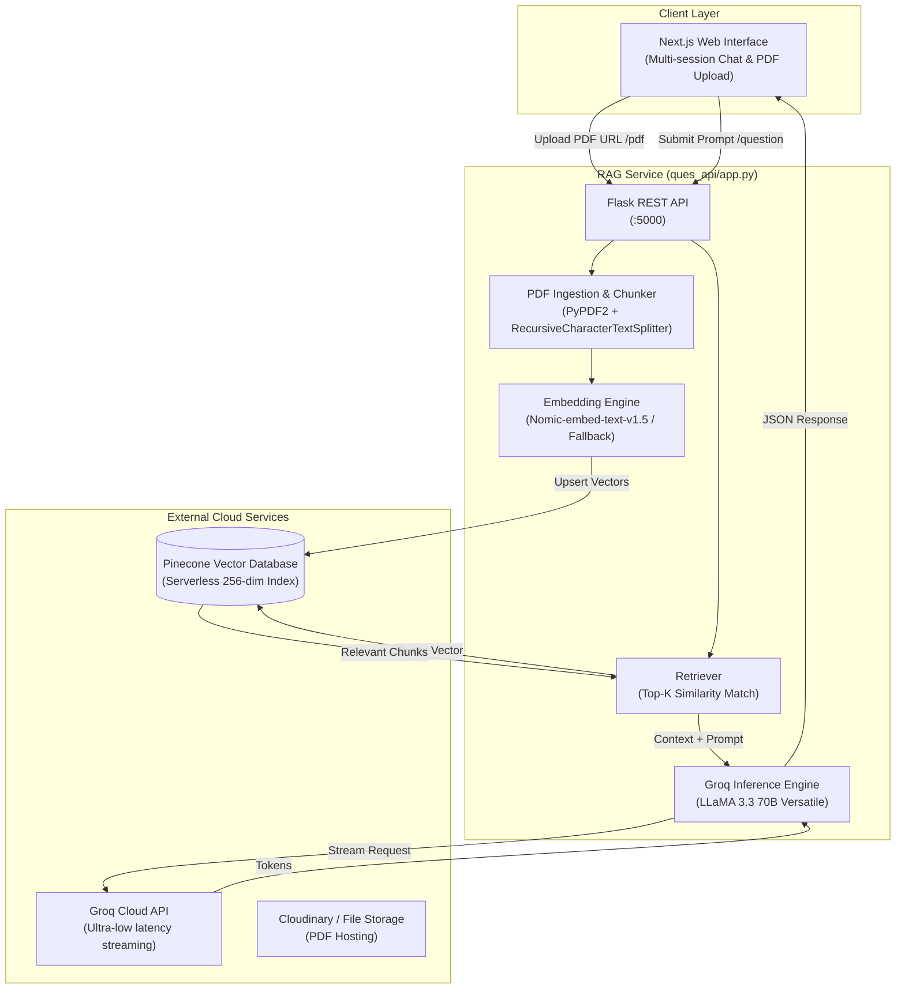
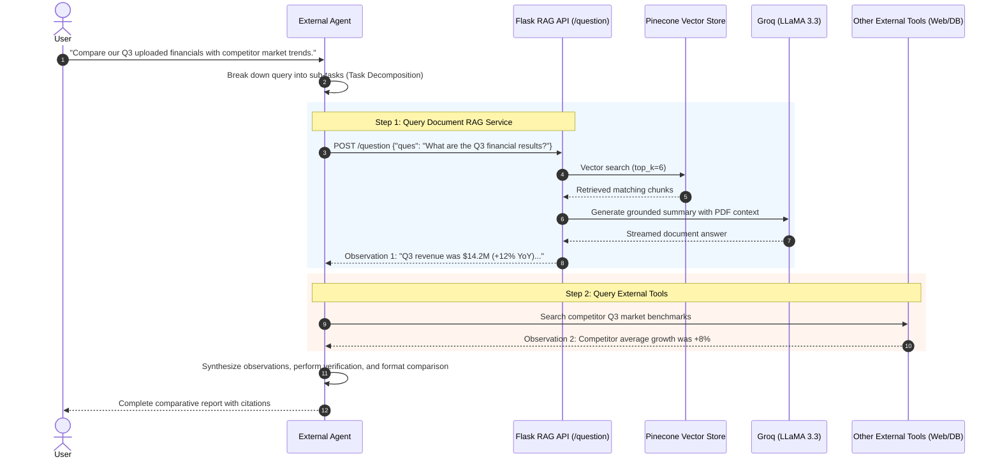

# Document Intelligence & RAG System (with External Agent Architecture)

A full-stack, high-performance Document Question-Answering and Retrieval-Augmented Generation (RAG) platform. The system pairs a modern **Next.js** frontend with a **Flask** microservice, leveraging **Pinecone** for vector search, **Nomic** for embeddings, **Groq (LLaMA 3.3 70B)** for ultra-fast generation, and is architected to interface seamlessly with **External Autonomous AI Agents**.

---

## Table of Contents

- [System Architecture Overview](#system-architecture-overview)
  - [Excalidraw-Style Architecture Diagram](#excalidraw-style-architecture-diagram)
  - [1. Current Direct RAG Architecture](#1-current-direct-rag-architecture)
  - [2. Extended Architecture with External Agent](#2-extended-architecture-with-external-agent)
- [Agentic vs. Direct LLM Pipeline](#agentic-vs-direct-llm-pipeline)
- [External Agent Integration Design](#external-agent-integration-design)
  - [Agent Role & Responsibilities](#agent-role--responsibilities)
  - [Tool Schema Definition](#tool-schema-definition)
  - [Agent Implementation Example (Python / Tool-Use)](#agent-implementation-example-python--tool-use)
- [Project Directory Structure](#project-directory-structure)
- [API Reference](#api-reference)
- [Getting Started](#getting-started)
  - [Backend Setup (`ques_api`)](#backend-setup-ques_api)
  - [Frontend Setup (`frontend`)](#frontend-setup-frontend)
- [Environment Variables & Configuration](#environment-variables--configuration)

---

## System Architecture Overview

### Excalidraw-Style Architecture Diagram



```text
┌────────────────────────┐      (Complex Task)       ┌────────────────────────────────────────────────────────┐
│     USER / OPERATOR    │ ────────────────────────> │          EXTERNAL AUTONOMOUS AGENT LAYER               │
└───────────┬────────────┘                           │   ┌────────────────────────────────────────────────┐   │
            │                                        │   │   Agent Brain (LangGraph / CrewAI / ReAct)     │   │
            │ (Direct Query)                         │   │   • Planner   • Memory   • Self-Correction     │   │
            ▼                                        │   └───────────────────────┬────────────────────────┘   │
┌────────────────────────┐                           │                           │ (Tool Selection)           │
│   Next.js 15 Client    │                           │                           ▼                            │
│   • Multi-session Chat │                           │   ┌────────────────────────────────────────────────┐   │
│   • Cloudinary Upload  │                           │   │ [RAG Tool]     [Web Search]     [SQL/DB Tool]  │   │
└───────────┬────────────┘                           └───────────┬────────────────────────────────────────────┘
            │                                                    │
            │ (POST /question or /pdf)                           │ (Invokes Document Tool)
            └─────────────────────────┬──────────────────────────┘
                                      ▼
             ┌─────────────────────────────────────────────────────────────────┐
             │                   FLASK RAG SERVICE (:5000)                     │
             │   ┌───────────────────────────┐   ┌──────────────────────────┐  │
             │   │ PDF Parser & Chunker      │   │ Nomic Embedding (256d)   │  │
             │   │ (PyPDF2 + RecursiveSplit) │   │ (Model or Fallback)      │  │
             │   └─────────────┬─────────────┘   └─────────────┬────────────┘  │
             │                 │                               │               │
             │   ┌─────────────▼─────────────┐   ┌─────────────▼────────────┐  │
             │   │ Pinecone Vector Retrieval │   │ Groq Prompt & LLaMA 3.3  │  │
             │   │ (Top-6 Cosine Similarity) │   │ (Ultra-low latency Gen)  │  │
             │   └─────────────┬─────────────┘   └─────────────┬────────────┘  │
             └─────────────────┼───────────────────────────────┼───────────────┘
                               │                               │
            ┌──────────────────┴───────────────┐               │
            ▼                                  ▼               ▼
┌────────────────────────┐         ┌───────────────────────────────┐
│  PINECONE VECTOR DB    │         │       GROQ LPU CLOUD          │
│  • Serverless Index    │         │       • llama-3.3-70b         │
│  • 256-dim Cosine      │         │       • Real-time Streaming   │
└────────────────────────┘         └───────────────────────────────┘
```

---

### 1. Current Direct RAG Architecture

The native system operates as a single-pass, direct RAG pipeline:



---

### 2. Extended Architecture with External Agent

When connected to an **External Agent** (e.g., LangGraph, CrewAI, AutoGen, or an MCP/Tool-Calling Agent), the RAG service acts as a **specialized retrieval and document grounding tool**. The External Agent controls multi-step reasoning, external data lookup, tool delegation, and iterative synthesis:

```mermaid
flowchart TB
    User(["User / Operator"])

    subgraph AgentLayer ["External Autonomous Agent Layer"]
        AgentCore["Autonomous Agent Brain\n(ReAct / Plan-and-Execute Loop)"]
        Planner["Task Decomposition & Planner"]
        Memory["Conversation & Execution Memory"]
        ToolRegistry["Agent Tool Registry"]
    end

    subgraph Tools ["Agent Toolset"]
        RAGTool["RAG Document Tool\n(calls ques_api /question & /pdf)"]
        WebSearchTool["Web Search Tool\n(Google/Tavily/DuckDuckGo)"]
        DBTool["Enterprise DB / SQL Tool"]
        CodeTool["Code Execution Sandbox"]
    end

    subgraph CorePlatform ["Document RAG Platform"]
        API["Flask RAG API (:5000)"]
        Pinecone[("Pinecone Vector Index")]
        GroqLLM["Groq LLaMA 3.3 70B"]
    end

    User -->|Complex Multi-Step Request| AgentCore
    AgentCore <--> Planner
    AgentCore <--> Memory
    AgentCore --> ToolRegistry
    ToolRegistry --> RAGTool
    ToolRegistry --> WebSearchTool
    ToolRegistry --> DBTool
    ToolRegistry --> CodeTool

    RAGTool -->|POST /question (Semantic Search & PDF Grounding)| API
    RAGTool -->|POST /pdf (Index New Document)| API
    API <--> Pinecone
    API <--> GroqLLM
    API -->|Grounded Context & Document Answer| RAGTool
    RAGTool -->|Observation| AgentCore

    AgentCore -->|Synthesized Multi-Source Final Answer| User
```

---

### Sequence Flow: External Agent Execution



---

## Agentic vs. Direct LLM Pipeline

| Feature | Direct RAG Pipeline (`ques_api` default) | With External Agent |
| :--- | :--- | :--- |
| **Agent Count** | **0 Agents** (Pure REST + RAG pipeline) | **1+ Agents** (Orchestrator, Critic, Researcher) |
| **Workflow Control** | Linear: Input $\rightarrow$ Retrieve $\rightarrow$ Generate $\rightarrow$ Output | Dynamic: Loop of Reason $\rightarrow$ Act $\rightarrow$ Observe |
| **Multi-Hop Queries** | Single-shot; cannot break down compound inquiries | Decomposes compound questions into iterative queries |
| **Tool Usage** | Fixed to internal vector store & PDF context | Dynamically invokes RAG + Web Search + Code + Databases |
| **Error Recovery** | Static fallback text | Self-correcting: re-phrases queries if context is insufficient |

---

## External Agent Integration Design

### Agent Role & Responsibilities

1. **Query Decomposition**: Breaks compound questions (e.g., *"Compare section 2 of this policy with California labor laws"*) into two distinct actions: querying the internal document RAG and querying an external legal database.
2. **Context Routing**: Determines when a user query pertains to the uploaded document vs. general knowledge.
3. **Multi-Document & Cross-Source Synthesis**: Aggregates answers returned by `ques_api` with real-time web lookups, internal SQL databases, or CRM systems.
4. **Verification & Fact Checking**: Compares the LLM response against raw document chunks to prevent hallucinations before presenting findings to the user.

### Tool Schema Definition

When exposing `ques_api` to an OpenAI / Anthropic / LangChain / MCP compatible external agent, use the following tool definition:

```json
{
  "name": "query_document_rag",
  "description": "Searches and answers questions based on uploaded PDF documents using vector semantic search and grounded LLaMA-3.3-70B inference.",
  "parameters": {
    "type": "object",
    "properties": {
      "ques": {
        "type": "string",
        "description": "The specific question or query to ask the document knowledge base."
      }
    },
    "required": ["ques"]
  }
}
```

```json
{
  "name": "index_document_url",
  "description": "Downloads, extracts, chunks, and indexes a remote PDF document into the vector knowledge base.",
  "parameters": {
    "type": "object",
    "properties": {
      "url": {
        "type": "string",
        "description": "The public or pre-signed URL of the PDF document to download and vectorize."
      }
    },
    "required": ["url"]
  }
}
```

---

### Agent Implementation Example (Python / Tool-Use)

Below is an example showing how an **External Agent** written with LangChain, LangGraph, or Groq/OpenAI tool calling integrates with this project:

```python
import requests
import json
from groq import Groq

# 1. Define the RAG API Tool Wrapper
RAG_API_BASE = "http://localhost:5000"

def query_document_rag(ques: str) -> str:
    """Invokes the internal Document RAG API."""
    response = requests.post(f"{RAG_API_BASE}/question", json={"ques": ques})
    if response.status_code == 200:
        return response.json().get("responce", "No response content.")
    return f"Error from RAG API: {response.status_code} - {response.text}"

def index_pdf_document(pdf_url: str) -> str:
    """Indexes a new PDF into the vector store."""
    response = requests.post(f"{RAG_API_BASE}/pdf", json={"url": pdf_url})
    return response.json().get("message", "Uploaded successfully.")

# 2. Agent Execution Loop with Tool Calling
tools = [
    {
        "type": "function",
        "function": {
            "name": "query_document_rag",
            "description": "Query the indexed PDF document knowledge base.",
            "parameters": {
                "type": "object",
                "properties": {
                    "ques": {"type": "string", "description": "The query to search in the document."}
                },
                "required": ["ques"],
            },
        },
    }
]

client = Groq()

def run_agent(user_query: str):
    messages = [
        {"role": "system", "content": "You are an autonomous research agent. Use the document RAG tool to inspect facts before answering."},
        {"role": "user", "content": user_query}
    ]

    response = client.chat.completions.create(
        model="llama-3.3-70b-versatile",
        messages=messages,
        tools=tools,
        tool_choice="auto"
    )
    
    choice = response.choices[0].message
    if choice.tool_calls:
        for tool_call in choice.tool_calls:
            if tool_call.function.name == "query_document_rag":
                args = json.loads(tool_call.function.arguments)
                tool_output = query_document_rag(args["ques"])
                
                # Append tool result back to agent conversation memory
                messages.append(choice)
                messages.append({
                    "role": "tool",
                    "tool_call_id": tool_call.id,
                    "name": "query_document_rag",
                    "content": tool_output
                })

        # Final Agent Synthesis
        final_response = client.chat.completions.create(
            model="llama-3.3-70b-versatile",
            messages=messages
        )
        return final_response.choices[0].message.content
    
    return choice.content
```

---

## Project Directory Structure

```plaintext
mgg/
├── README.md                 # System architecture & external agent integration guide
│
├── ques_api/                 # Python Flask RAG Service
│   ├── app.py                # Core API, Pinecone indexing, Nomic embeddings, Groq LLM
│   ├── requirements.txt      # Python dependencies (Flask, Pinecone, Groq, LangChain, etc.)
│   └── downloaded.pdf        # Local cached instance of the current active PDF
│
└── frontend/                 # Next.js 15 Web Application
    ├── package.json          # Node dependencies (Next.js, React, Tailwind, Lucide, etc.)
    ├── src/
    │   └── app/
    │       ├── layout.tsx    # Root HTML layout and font definitions
    │       ├── globals.css   # Modern dark/light design system
    │       └── page.tsx      # Interactive chat UI, PDF uploader, settings modal
    └── public/               # Static assets and icons
```

---

## API Reference

The backend exposes a lightweight REST interface running by default on `http://localhost:5000`:

| Endpoint | Method | Payload | Description |
| :--- | :--- | :--- | :--- |
| `/health` | `GET` | _None_ | Returns `{"status": "ok"}` to confirm the service is operational. |
| `/pdf` | `POST` | `{"url": "<pdf_url>"}` | Downloads the PDF, creates chunks (1200 chars / 200 overlap), generates 256-dim embeddings, and upserts them to Pinecone. |
| `/question` | `POST` | `{"ques": "<query>"}` | Embeds query, performs top-6 similarity search in Pinecone, injects context into Groq LLaMA 3.3 70B, and streams the answer. |
| `/reset` | `POST` / `DELETE` | _None_ | Wipes all vectors in Pinecone and deletes locally cached PDFs. |

---

## Getting Started

### Backend Setup (`ques_api`)

1. **Navigate to the API folder:**
   ```bash
   cd ques_api
   ```

2. **Create and activate a virtual environment:**
   ```bash
   # Windows (PowerShell)
   python -m venv venv
   .\venv\Scripts\Activate.ps1
   ```

3. **Install dependencies:**
   ```bash
   pip install -r requirements.txt
   ```

4. **Run the API server:**
   ```bash
   python app.py
   ```
   *The server will start on `http://localhost:5000` with CORS enabled.*

---

### Frontend Setup (`frontend`)

1. **Navigate to the frontend folder:**
   ```bash
   cd frontend
   ```

2. **Install node dependencies:**
   ```bash
   npm install
   ```

3. **Start the Next.js development server:**
   ```bash
   npm run dev
   ```

4. **Access the application:**
   Open [http://localhost:3000](http://localhost:3000) in your browser. Configure your backend URL (`http://localhost:5000`) in the UI Settings modal if running on custom ports.

---

## Environment Variables & Configuration

For production deployment, configure the following keys in your `.env` or system environment variables:

| Variable | Description | Default Provider |
| :--- | :--- | :--- |
| `GROQ_API_KEY` | API key for high-speed LLaMA 3.3 70B inference | [Groq Cloud Console](https://console.groq.com) |
| `PINECONE_API_KEY` | API key for Pinecone vector database | [Pinecone Console](https://app.pinecone.io) |
| `PINECONE_INDEX` | Index name configured for 256 dimensions (cosine similarity) | `lang` |
| `NOMIC_API_KEY` | Nomic Embed Text API key (has deterministic fallback if omitted) | [Nomic Atlas](https://atlas.nomic.ai) |
| `NEXT_PUBLIC_BACKEND_URL` | Backend URL consumed by the Next.js frontend | `http://localhost:5000` |
| `NEXT_PUBLIC_CLOUDINARY_CLOUD_NAME` | Cloudinary cloud name for direct PDF uploads | Configurable via UI |
| `NEXT_PUBLIC_CLOUDINARY_UPLOAD_PRESET`| Cloudinary unsigned upload preset | Configurable via UI |
